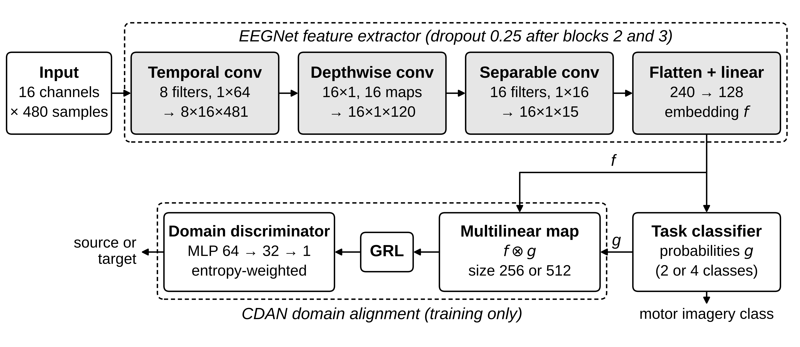
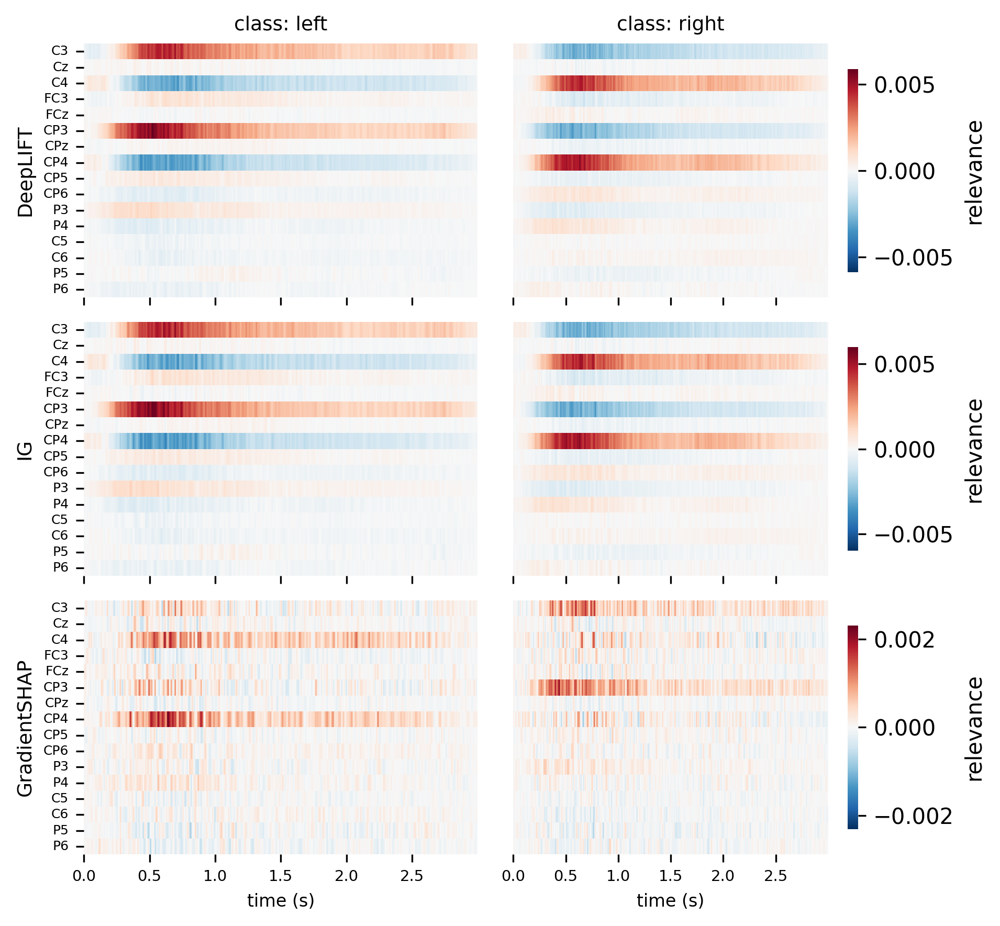
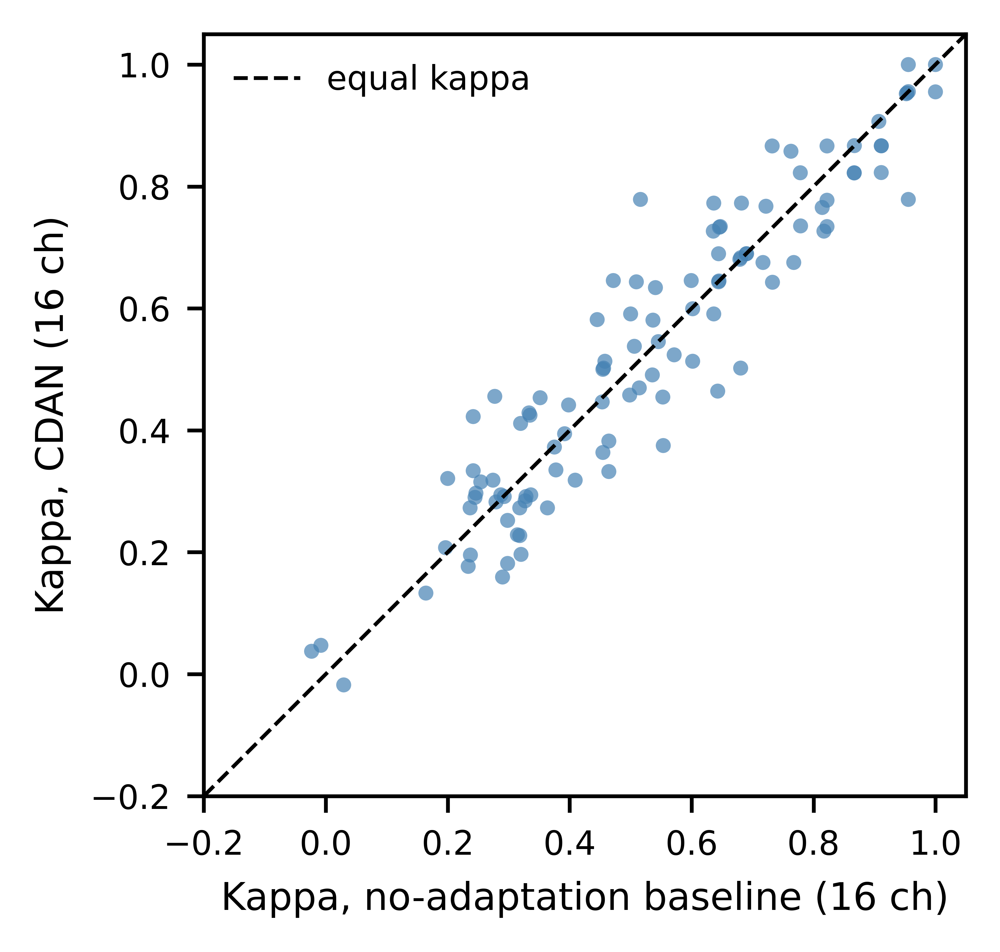

# Interpreting Domain Adaptation in Cross-Subject EEG Classification Using Explainable AI

Code for my MSc thesis in Computer Science (Big Data and AI) at SRH University, Berlin.

EEG classifiers trained on one group of people usually lose accuracy on a new person, because brain signals differ between subjects. In this project I trained a conditional domain adversarial network (CDAN) with an EEGNet feature extractor for cross-subject motor imagery classification. I then used four attribution methods to look at which channels and time windows the model relies on for each new subject. The aim was to look past the accuracy score and understand why transfer works for some subjects and fails for others.

## Data

PhysioNet EEG Motor Movement/Imagery Dataset (EEGMMIDB): 109 subjects, 64 channels, 160 Hz.

- Subjects S088, S092 and S100 were excluded because they were recorded at 128 Hz. This leaves 106 subjects.
- The models use 16 channels over the sensorimotor area: C3, Cz, C4, FC3, FCz, CP3, CPz, CP4, CP5, CP6, P3, P4, C5, C6, P5, P6.
- Two tasks: binary (left hand vs right hand imagery) and multiclass (left hand, right hand, both fists, both feet).

The data is not included in this repository. Download it from https://physionet.org/content/eegmmidb/1.0.0/ and place it at:

    Data/raw/physionet_mi_data/eeg-motor-movementimagery-dataset/

## Method

- Preprocessing: filtering, 3-second epochs from cue onset (480 samples), trial rejection with a hybrid peak-to-peak and IQR rule, z-score normalisation, and selection of the 16 channels (notebooks 01).
- Model: EEGNet feature extractor with a CDAN domain discriminator (gradient reversal, entropy weighting). The discriminator is only used during training.
- Evaluation: leave-one-subject-out cross-validation (LOSO), so each of the 106 subjects is the unseen target once. Cohen's kappa is the main metric. The results below use kappa stopping.
- Attribution: Layer-wise Relevance Propagation (LRP), DeepLIFT, GradientSHAP and Integrated Gradients (IG), all through Captum.

## Results

| Task (CDAN, 16 channels) | Mean Cohen's kappa (LOSO, 106 subjects) | Subjects above chance |
|---|---|---|
| Binary (left vs right hand) | 0.5332 | 103 / 106 |
| Multiclass (4 classes) | 0.3415 | 97 / 106 |

Main findings from the attribution analysis:

- The attribution maps gave more relevance to the ipsilateral channels of the imagined action, across all performance and category groups and in three of the four methods. GradientSHAP was the exception. The relevance was concentrated 0.3 to 1.0 s after the cue.
- LRP, DeepLIFT and IG produced very similar maps. GradientSHAP agreed much less with the other three.
- In the multiclass task each class had its own spatial pattern.
- The direction of attribution was the same for all 106 subjects, but its strength went down from the high-performance group to the low-performance group (Mann-Whitney U, p = 0.0038 for the left-hand class and p = 0.0020 for the right-hand class).
- Failed transfer did not have a single cause. Three types showed up: selective class collapse (Group A), lack of attribution across all classes (Group B), and problems in the signal itself (negative-transfer group).
- The maps separated these groups from each other, but they did not explain the differences between individual subjects among the 87 above-chance subjects.

### Comparison with a no-adaptation baseline

| Model | Channels | Binary kappa (kappa stopping) |
|---|---|---|
| No-adaptation baseline | 8 | 0.4996 |
| No-adaptation baseline | 16 | 0.5330 |
| CDAN | 16 | 0.5332 |

With the same 16 channels, CDAN and the no-adaptation baseline reached almost the same mean kappa (difference +0.0003, 95% CI −0.0157 to +0.0160, Wilcoxon p = 0.925). The improvement over the 8-channel baseline is about the same size as the gain the baseline itself gets from going from 8 to 16 channels. The reasons were not examined. One possible explanation is that training settings such as the domain loss weight and the warmup length need more tuning for the 16-channel configuration.

### Limitations

- Only one dataset (PhysioNetMI), with healthy subjects only, so the results may not hold for other datasets or for patients.
- The reported epoch was chosen using the target subject's kappa, so the values may be higher than in a setting where no target labels are available.
- The 16 channels were chosen using the class labels of all 106 subjects. The same channels were used for every model, including the baseline.
- Group B and the negative-transfer group have only three subjects each, so their patterns should be read with caution.
- Different attribution methods can give different maps for the same model, as the GradientSHAP results show.

## Repository structure

    functions/      Python modules: data loading, models, training, metrics, pipeline, attribution and plotting
    notebooks/      Analysis notebooks, run in numbered order
      dataset_review/   Lee2019 and Stieger2021 datasets, reviewed during dataset selection
    figures/        Figures used in this README
    requirements.txt

`Data/` and `results/` are created in the repository root when you run the notebooks. Both are excluded from git.

## Notebooks

| Notebook | Purpose |
|---|---|
| 00_physionetMI_data_exploration | Raw data exploration: epochs, PSD checks, sampling rates and the final subject list |
| 01_preprocessing | Preprocessing for the 106 subjects |
| 01_preprocessing_extension | Multiclass (4-class) data and the 16-channel expansion |
| 02_domain_adaptation | CDAN pipeline and LOSO training |
| 03_results_analysis | Results, baseline comparison, gradient penalty and negative-transfer subjects |
| 04_config_setup.py | Shared setup for the attribution notebooks |
| 04.1_LRP_xai | LRP attributions, including a check of the saved model checkpoints |
| 04.2_deeplift_xai, 04.3_shap_xai, 04.4_ig_xai | DeepLIFT, GradientSHAP and Integrated Gradients attributions |
| 04_xai_analysis | Combined attribution analysis by subject group and class |
| 05_verification_and_tables | Checks and tables |
| 06_signal_check | Signal checks on raw and preprocessed data |
| 07_thesis_verification | Final check of the reported numbers |

Outputs of the larger notebooks were cleared to keep the repository small. Run them to regenerate the figures.

## Setup

Developed with Python 3.12.

    python3.12 -m venv .venv
    source .venv/bin/activate
    pip install -r requirements.txt

Run the notebooks from inside the `notebooks/` folder. They expect `Data/` and `results/` in the repository root. The Python modules find the repository root on their own. If your data and results are stored elsewhere, set the environment variable `EEG_PROJECT_ROOT` to that folder.

## Citation

Singhania, A. R. (2026). Interpreting Domain Adaptation in Cross-Subject EEG Classification Using Explainable AI. MSc thesis, SRH University, Berlin. ORCID: 0009-0002-4780-6821.

## References

- Schalk, G., McFarland, D. J., Hinterberger, T., Birbaumer, N., Wolpaw, J. R. (2004). BCI2000: A general-purpose brain-computer interface (BCI) system. IEEE Transactions on Biomedical Engineering, 51(6), 1034-1043.
- Goldberger, A. L., et al. (2000). PhysioBank, PhysioToolkit, and PhysioNet. Circulation, 101(23), e215-e220.
- Lawhern, V. J., et al. (2018). EEGNet: A compact convolutional neural network for EEG-based brain-computer interfaces. Journal of Neural Engineering, 15(5).
- Long, M., Cao, Z., Wang, J., Jordan, M. I. (2018). Conditional adversarial domain adaptation. NeurIPS.
- Kokhlikyan, N., et al. (2020). Captum: A unified and generic model interpretability library for PyTorch. arXiv:2009.07896.

## License

The code is released under the MIT License (see `LICENSE`). The dataset is not part of this repository and is covered by its own licence on PhysioNet.
